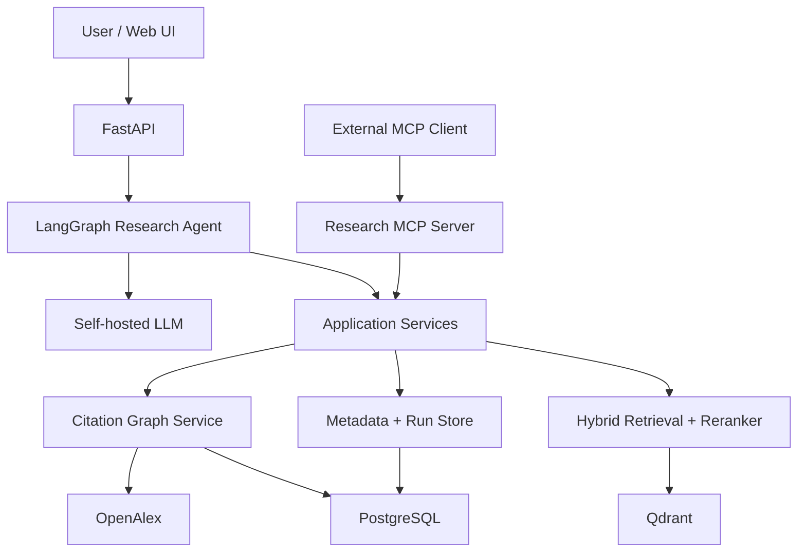

# Scientific Research Platform

This platform searches scientific papers, retrieves and reranks evidence, and follows citation relationships. It returns research answers with claims that can be traced to source passages and paper metadata. Its services are available through both the web API and a shared MCP server ([project specification](docs/agents/scientific-research-platform-source-of-truth.md), [MCP architecture](docs/adr/0030-phase5-mcp-adapter.md)).

## What it shows

- **Hybrid retrieval and reranking:** the selected v10 profile passed all 16 gates in the one-time v14 held-out assessment; three quality gates passed by narrow margins inside sampling noise ([benchmarks](docs/reference/benchmarks.md), [profile decision](docs/adr/0017-phase2-accepted-profile-v10.md)).
- **A bounded LangGraph agent:** the fully sampled development sweep completed 42 of 42 runs within configured run and tool budgets, with no unknown evidence handles or completed-run budget violations. These are operational results, not answer-quality gates ([benchmarks](docs/reference/benchmarks.md)).
- **Claim → quote → passage → paper verification:** quote checks rejected 7 of 15 partial or unsupported claims and 2 of 60 supported claims in the reviewed sample; verification can filter unsupported drafts and reject some supported ones ([failure analysis](docs/reference/failure-analysis.md), [ADR-0025](docs/adr/0025-verified-quote-synthesis-with-thinking.md)).
- **Observable, reproducible runs:** `research-runs explain` inspects a run diagnosis and `research-runs reproduce` checks its recorded configuration; all five accepted Phase 4 walkthroughs reproduced with matching configuration hashes ([Phase 4 gate report](docs/reference/phase-4-gate-report.md)).
- **One MCP server over shared services:** parity and security checks passed in CI; a local run at the gate commit had 1,407 passed and 114 skipped tests ([Phase 5 gate report](docs/reference/phase-5-gate-report.md), [ADR-0030](docs/adr/0030-phase5-mcp-adapter.md)).

## Architecture

This is the system context from section 5 of the [project specification](docs/agents/scientific-research-platform-source-of-truth.md).



See the [architecture overview](docs/architecture/overview.md) for components and request flow.

## Try it (about 10 minutes, CPU only)

The commands are implemented by [`scripts/demo_load.sh`](scripts/demo_load.sh). On 2026-10-14 a fresh clone completed it in 634 seconds on a laptop CPU, most of it downloading the image, the bundle and the models.

```bash
git clone https://github.com/avsngh-git/RAGpipeline.git
cd RAGpipeline
scripts/demo_load.sh
docker compose up -d
```

The loader downloads the [`demo-data-v1`](https://github.com/avsngh-git/RAGpipeline/releases/tag/demo-data-v1) bundle (354 MB: the 100-paper corpus, its search indexes and eight showcase runs), verifies its checksum and prepares the local services ([Phase 6 plan](docs/plans/phase-6-portfolio.md), [display policy](docs/adr/0032-phase6-public-cc-by-demo-collection.md)). Then open `http://127.0.0.1:8000/`, paste the key saved in `demo-data/api-key`, and open one of the showcase run links printed by the script. The page lets you search the released collection and inspect its showcase runs. Public display is limited to material cleared by the document review ([ADR-0031](docs/adr/0031-phase5-external-passage-exposure.md), [ADR-0032](docs/adr/0032-phase6-public-cc-by-demo-collection.md)).

Requirements: Docker with Compose v2 ([Compose configuration](docker-compose.yml)), about 12 GB free disk, and 8 GB RAM. TODO(owner): verify the disk and memory estimates with a fresh-clone run and record the measurements in repository documentation. Live research runs need an NVIDIA GPU: `scripts/demo_load.sh --with-llm` ([generator setup](docs/operations/phase-3-generator.md)).

If you already run another checkout of this project with Docker Compose, give the demo its own project name and ports so the two stacks do not share containers or volumes; Compose names a project after its directory:

```bash
export COMPOSE_PROJECT_NAME=ragdemo POSTGRES_PORT=55432 QDRANT_PORT=56333 API_PORT=18000
scripts/demo_load.sh
docker compose up -d
```

The script then prints links on the chosen `API_PORT`.

Connect an MCP client to `http://127.0.0.1:8000/mcp/` with the same key ([MCP operations](docs/operations/mcp.md)).

## Video

TODO(owner): video link (P6-18).

## Results

| Measurement | Result | Caveat |
| --- | --- | --- |
| Phase 2 retrieval acceptance | 16 of 16 gates passed | Three quality gates passed by margins inside sampling noise; labels are assistant-reviewed ([benchmarks](docs/reference/benchmarks.md)). |
| Phase 3 run completion | 42 of 42 in the fully sampled sweep | Development families only; answer quality was not gated ([benchmarks](docs/reference/benchmarks.md)). |
| Phase 4 reproduction | 5 of 5 accepted walkthroughs reproduced | Development walkthroughs, not a broad quality benchmark ([Phase 4 gate report](docs/reference/phase-4-gate-report.md)). |

See [benchmarks](docs/reference/benchmarks.md) and [failure analysis](docs/reference/failure-analysis.md) for methods, uncertainty, and limitations.

## Design decisions

- Qdrant runs dense and sparse retrieval in one search service ([ADR-0022](docs/adr/0022-phase35-qdrant-search-and-content.md)).
- PostgreSQL is authoritative; Qdrant is derived and rebuildable ([ADR-0023](docs/adr/0023-phase35-index-generations.md)).
- The accepted retrieval profile combines gte-modernbert-base dense search, BM25 lexical scoring with the `scientific-en` analyzer (accepted with BM25S, served as Qdrant sparse vectors after a parity check, [ADR-0022](docs/adr/0022-phase35-qdrant-search-and-content.md)), and the Ettin-150M reranker ([ADR-0017](docs/adr/0017-phase2-accepted-profile-v10.md)).
- Research runs use resumable LangGraph checkpoints ([ADR-0019](docs/adr/0019-phase3-research-run-execution.md)).
- Claims use verified quotes and evidence mappings ([ADR-0025](docs/adr/0025-verified-quote-synthesis-with-thinking.md)).
- API keys carry scopes and runs have ownership ([ADR-0027](docs/adr/0027-phase4-authentication-and-rate-limits.md)).
- Traces and run records preserve diagnostic and configuration provenance ([ADR-0026](docs/adr/0026-phase4-observability-and-run-records.md)).
- MCP handlers and HTTP routes share research capabilities; passage exposure follows a separate policy ([ADR-0030](docs/adr/0030-phase5-mcp-adapter.md), [ADR-0031](docs/adr/0031-phase5-external-passage-exposure.md)).
- The delivery uses a released image and local CPU mode; public hosting is optional ([ADR-0033](docs/adr/0033-phase6-delivery-without-hosting.md)).

## Limitations

- The accepted corpus contains 100 papers; retrieval results do not establish performance across scientific literature ([benchmarks](docs/reference/benchmarks.md)).
- Agent and answer-quality observations come from development sets and remain diagnostic ([benchmarks](docs/reference/benchmarks.md)).
- The generator sometimes abstains when reviewed evidence is partly answerable; two prompt trials did not reduce this behavior ([failure analysis](docs/reference/failure-analysis.md), [ADR-0029](docs/adr/0029-claim-scope-words-and-prompt-trials.md)).
- The planner rarely chooses paper discovery in development runs; this work remains in [backlog #115](https://github.com/avsngh-git/RAGpipeline/issues/115) ([failure analysis](docs/reference/failure-analysis.md)).
- CPU small mode is slower than the GPU benchmark path and is intended for review, not benchmarking; CPU retrieval latency has not been measured ([benchmarks](docs/reference/benchmarks.md), [Phase 6 plan](docs/plans/phase-6-portfolio.md)).

## Development

Create the Conda environment and install the package in editable mode ([environment definition](environment.yaml)):

```bash
conda env create --file environment.yaml
conda activate sci_research_agent
python -m pip install --no-build-isolation --no-deps -e .
```

Run the project checks from the repository root:

```bash
python -m ruff check .
python -m ruff format --check .
python -m mypy
python -m pytest
```

Integration tests skip unless `RESEARCH_PLATFORM_TEST_DATABASE_URL` and `RESEARCH_PLATFORM_TEST_QDRANT_URL` point to disposable services. The PostgreSQL URL must use a dedicated `research_test` database; tests apply migrations and enforce constraints. CI supplies fresh service containers ([evaluation operations](docs/operations/evaluation.md)). See also the [observability](docs/operations/observability.md), [retention](docs/operations/retention.md), [authentication](docs/operations/authentication.md), and [serving environment](docs/operations/serving-environment.md) guides.

## Data and licences

The code is licensed under [MIT](LICENSE). Demo passages are CC BY excerpts and are listed in the downloaded bundle's `ATTRIBUTION.md`; only documents cleared for display are included ([ADR-0032](docs/adr/0032-phase6-public-cc-by-demo-collection.md)). Send takedown requests through a [GitHub issue](https://github.com/avsngh-git/RAGpipeline/issues/new).

## Project history

See [docs/history.md](docs/history.md) for the phase log and [the project source of truth](docs/agents/scientific-research-platform-source-of-truth.md) for the current specification.
