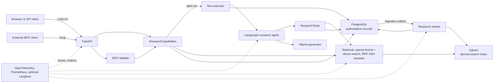
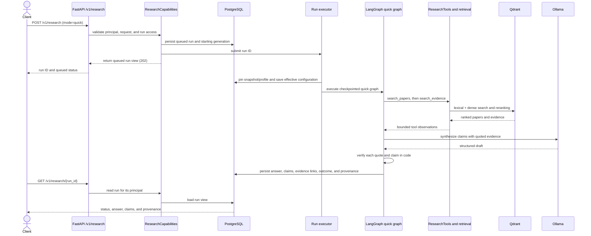

# Architecture overview

## Purpose

The Scientific Research Platform searches a fixed scholarly snapshot, gathers source-linked evidence, and returns a research answer whose claims can be checked against cited passages. This page describes the production design and the small local demonstration mode. The [project source of truth](../agents/scientific-research-platform-source-of-truth.md) and accepted [Phase 6 delivery decision](../adr/0033-phase6-delivery-without-hosting.md) define the requirements behind it.

## Component diagram

FastAPI serves the web page at `/`, versioned HTTP endpoints under `/v1`, and mounts the MCP adapter at `/mcp`. `ResearchCapabilities` owns shared HTTP and MCP use cases. The run executor persists and queues a research run; LangGraph uses `ResearchTools` to call the same application services used for retrieval. Qdrant holds the searchable index, while PostgreSQL remains authoritative for metadata, permissions, and run records. A separate worker handles queued ingestion. Observability instruments requests, agent steps, retrieval, model calls, and persistence. See [ADR-0022](../adr/0022-phase35-qdrant-search-and-content.md), [ADR-0024](../adr/0024-phase35-online-discovery-and-ingestion.md), [ADR-0026](../adr/0026-phase4-observability-and-run-records.md), [ADR-0030](../adr/0030-phase5-mcp-adapter.md), and the [Phase 6 delivery decision](../adr/0033-phase6-delivery-without-hosting.md).

## Components

| Component | Responsibility | Key module | Decision |
| --- | --- | --- | --- |
| HTTP API | Validates requests, authenticates principals, and maps results to HTTP responses. | [`api/app.py`](../../src/research_platform/api/app.py), [`api/routes.py`](../../src/research_platform/api/routes.py), [`api/research_routes.py`](../../src/research_platform/api/research_routes.py) | [ADR-0027](../adr/0027-phase4-authentication-and-rate-limits.md) |
| Shared capabilities | Implements search, paper reads, citation pages, serving identity, and run start/read use cases for HTTP and MCP. | [`services/capabilities.py`](../../src/research_platform/services/capabilities.py) | [ADR-0030](../adr/0030-phase5-mcp-adapter.md) |
| MCP adapter | Exposes selected application capabilities over authenticated Streamable HTTP. | [`mcp/mount.py`](../../src/research_platform/mcp/mount.py), [`mcp/server.py`](../../src/research_platform/mcp/server.py), [`mcp/search_tools.py`](../../src/research_platform/mcp/search_tools.py) | [ADR-0030](../adr/0030-phase5-mcp-adapter.md), [ADR-0031](../adr/0031-phase5-external-passage-exposure.md) |
| Research agent | Runs the fixed `quick` workflow or the bounded `deep_research` planning workflow. | [`agents/graph_quick.py`](../../src/research_platform/agents/graph_quick.py), [`agents/graph_deep.py`](../../src/research_platform/agents/graph_deep.py) | [ADR-0019](../adr/0019-phase3-research-run-execution.md) |
| Agent tools | Validates and executes typed actions against search, paper, citation, and ingestion services. | [`tools/research_tools.py`](../../src/research_platform/tools/research_tools.py) | [ADR-0019](../adr/0019-phase3-research-run-execution.md), [ADR-0024](../adr/0024-phase35-online-discovery-and-ingestion.md) |
| Retrieval | Applies filters, runs lexical and dense retrieval, fuses ranks, reranks candidates, and selects evidence. | [`search/application.py`](../../src/research_platform/search/application.py), [`search/hybrid_search.py`](../../src/research_platform/search/hybrid_search.py), [`search/fusion.py`](../../src/research_platform/search/fusion.py), [`search/reranker.py`](../../src/research_platform/search/reranker.py) | [ADR-0017](../adr/0017-phase2-accepted-profile-v10.md), [ADR-0022](../adr/0022-phase35-qdrant-search-and-content.md) |
| PostgreSQL and run records | Stores authoritative metadata, permissions, snapshots, generations, run state, claims, and configuration provenance. | [`runs/repository.py`](../../src/research_platform/runs/repository.py), [`runs/runner.py`](../../src/research_platform/runs/runner.py), [`persistence/migrations.py`](../../src/research_platform/persistence/migrations.py) | [ADR-0023](../adr/0023-phase35-index-generations.md), [ADR-0026](../adr/0026-phase4-observability-and-run-records.md) |
| Qdrant index | Serves dense and sparse search and source-linked evidence payloads; it can be rebuilt from authoritative records and artifacts. | [`search/dense_search.py`](../../src/research_platform/search/dense_search.py), [`search/sparse_lexical.py`](../../src/research_platform/search/sparse_lexical.py), [`ingestion/generation_index.py`](../../src/research_platform/ingestion/generation_index.py) | [ADR-0022](../adr/0022-phase35-qdrant-search-and-content.md), [ADR-0023](../adr/0023-phase35-index-generations.md) |
| Generator | Produces structured answer drafts through the local Ollama adapter. | [`llm/ollama.py`](../../src/research_platform/llm/ollama.py), [`agents/answering.py`](../../src/research_platform/agents/answering.py) | [ADR-0021](../adr/0021-phase3-qwen35-2b-gpu.md), [ADR-0025](../adr/0025-verified-quote-synthesis-with-thinking.md) |
| Ingestion worker | Claims queued ingestion work and publishes validated index generations. | [`worker/main.py`](../../src/research_platform/worker/main.py), [`worker/handlers.py`](../../src/research_platform/worker/handlers.py) | [ADR-0024](../adr/0024-phase35-online-discovery-and-ingestion.md) |
| Observability | Emits traces, structured logs, and metrics; Langfuse is an optional trace exporter. | [`observability/tracing.py`](../../src/research_platform/observability/tracing.py), [`observability/metrics.py`](../../src/research_platform/observability/metrics.py) | [ADR-0026](../adr/0026-phase4-observability-and-run-records.md) |

## A research run, step by step

This sequence shows a `quick` request. `POST /v1/research` returns a queued run view; the run executor completes it asynchronously, and the client reads the result with `GET /v1/research/{run_id}`. The API creates the durable run record before it submits the run to the executor. The `quick` graph searches papers, searches evidence for selected candidates, records un-ingested candidates, and synthesizes an answer. See [`research_routes.py`](../../src/research_platform/api/research_routes.py), [`capabilities.py`](../../src/research_platform/services/capabilities.py), [`graph_quick.py`](../../src/research_platform/agents/graph_quick.py), and [ADR-0019](../adr/0019-phase3-research-run-execution.md).

`RunBudgets` records and enforces limits for planning rounds, actions per plan, tool calls, citation depth, evidence passages, synthesis tokens, model retries, active run time, resumes, ingestion waits, and synthesis attempts. `ToolLedger` caches repeated identical actions so they do not repeat backend work; the code has a total tool-call cap but no separate duplicate-call quota. Validated settings cap the model context. The quick graph requests up to 10 paper hits, selects up to five candidate IDs, and requests up to 20 evidence results. Run provenance stores the effective run budgets. See [`runs/contracts.py`](../../src/research_platform/runs/contracts.py), [`tools/research_tools.py`](../../src/research_platform/tools/research_tools.py), [`config.py`](../../src/research_platform/config.py), [`runs/runner.py`](../../src/research_platform/runs/runner.py), and [`agents/graph_quick.py`](../../src/research_platform/agents/graph_quick.py).

Quote verification occurs after the model returns a structured draft. Code resolves each evidence handle, confirms that the quote occurs in the cited passage, checks the claim against the quote, and drops claims that fail. If the quote itself passes, code may keep the quote as the claim. See [`agents/answering.py`](../../src/research_platform/agents/answering.py), [`agents/verification.py`](../../src/research_platform/agents/verification.py), and [ADR-0025](../adr/0025-verified-quote-synthesis-with-thinking.md).

## Search pipeline

The locked retrieval contract has seven stages: validate and normalize the query and filters; retrieve lexically; retrieve densely; fuse ranks; rerank with a cross-encoder; deduplicate and select within the context budget; then return evidence with scores and provenance. In `v10-qdrant`, the lexical branch uses Qdrant sparse vectors with the `scientific-en-v1` analyzer, and the dense branch uses `Alibaba-NLP/gte-modernbert-base`. Reciprocal Rank Fusion combines the branches before the `cross-encoder/ettin-reranker-150m-v1` reranks candidates. Full revisions and preprocessing settings are in the [frozen profile](../../benchmarks/phase2/frozen-profile-v10-qdrant.toml); the pipeline contract is in [source of truth §9.1](../agents/scientific-research-platform-source-of-truth.md) and [ADR-0022](../adr/0022-phase35-qdrant-search-and-content.md).

| Stage | Implementation |
| --- | --- |
| Query and filters | Validate the request and apply snapshot, year, and evidence filters before ranking. ([Source of truth §9.1](../agents/scientific-research-platform-source-of-truth.md), [ADR-0017](../adr/0017-phase2-accepted-profile-v10.md)) |
| Lexical search | Qdrant sparse IDF (`qdrant-v1.19.1-lucene-idf`), `scientific-en-v1` analyzer revision `v1`. ([Frozen profile](../../benchmarks/phase2/frozen-profile-v10-qdrant.toml)) |
| Dense search | gte-modernbert-base, pinned revision `e7f32e3c00f91d699e8c43b53106206bcc72bb22`, 768-dimensional vectors. ([Frozen profile](../../benchmarks/phase2/frozen-profile-v10-qdrant.toml)) |
| Fusion | RRF (`rrf-v1`) with rank constant 10. ([Frozen profile](../../benchmarks/phase2/frozen-profile-v10-qdrant.toml)) |
| Reranking | Ettin-150M, pinned revision `025501c4e0f9bbeb4c5b198318e0089ff061cc14`, fp16 profile precision. ([Frozen profile](../../benchmarks/phase2/frozen-profile-v10-qdrant.toml)) |
| Selection | Deduplicate and apply per-paper and result context budgets after ranking. ([Frozen profile](../../benchmarks/phase2/frozen-profile-v10-qdrant.toml)) |
| Results | Return paper or evidence hits with ranks, component scores, stable source IDs, and provenance. ([Source of truth §9.2](../agents/scientific-research-platform-source-of-truth.md), [ADR-0017](../adr/0017-phase2-accepted-profile-v10.md)) |

The [frozen profile](../../benchmarks/phase2/frozen-profile-v10-qdrant.toml) sets lexical, dense, and fused candidate pools to 50, reranks up to 16 candidates, and returns up to 10 results by default. It keeps up to five support passages per paper and limits evidence results to 4,000 tokens or 12,000 characters. Those are profile settings, not answer-quality guarantees. The profile file preserves its 2026-10-05 `inactive` label, while the later [source of truth §21](../agents/scientific-research-platform-source-of-truth.md) records that `v10-qdrant` serves by default after its parity gate. This overview follows the later status and uses the profile file for the exact retrieval settings.

## Data model and provenance

A snapshot fixes collection membership, selected document versions, and evidence configuration. Ingestion turns permitted source documents into extractions, sections, evidence units, and searchable chunks. A published index generation identifies the searchable Qdrant state; PostgreSQL and retained artifacts remain the source from which it can be checked or rebuilt. PostgreSQL also enforces snapshot membership and permission checks when search serves evidence. These boundaries are set by [ADR-0001](../adr/0001-versioned-corpus-evidence.md), [ADR-0022](../adr/0022-phase35-qdrant-search-and-content.md), and [ADR-0023](../adr/0023-phase35-index-generations.md).

A run pins its starting snapshot and generation so later publications do not silently change its search corpus. Its version-2 provenance records the effective configuration ID, code revision, model identity, prompt versions, retrieval profile, trace ID, and budgets. PostgreSQL run records store the effective configuration, tool and model calls, drafted claims and verdicts, and answer outcome; traces add timing. See [`runs/runner.py`](../../src/research_platform/runs/runner.py), [`runs/repository.py`](../../src/research_platform/runs/repository.py), [ADR-0023](../adr/0023-phase35-index-generations.md), and [ADR-0026](../adr/0026-phase4-observability-and-run-records.md).

## One capability, three transports

HTTP routes and MCP tools call `ResearchCapabilities`, which owns shared request deadlines, error mapping, response checks, snapshot validation, citation cursors, and active-run admission. The LangGraph agent uses typed `ResearchTools` against the same application services; it does not send its internal calls through MCP. Keeping these adapters over shared services avoids implementing retrieval or authorization separately in each interface. See [ADR-0030](../adr/0030-phase5-mcp-adapter.md), [`services/capabilities.py`](../../src/research_platform/services/capabilities.py), and [`tools/research_tools.py`](../../src/research_platform/tools/research_tools.py).

CI checks the shared behavior with transport parity tests and checks that the MCP adapter and capability service do not import database, vector-store, ranking, or agent modules. The tests are [`test_phase5_gate_parity.py`](../../tests/test_phase5_gate_parity.py) and [`test_phase5_gate_import_boundary.py`](../../tests/test_phase5_gate_import_boundary.py). The MCP security suite also checks the text policy and authorization boundaries; see [ADR-0030](../adr/0030-phase5-mcp-adapter.md).

## Security model

API keys are stored as hashes and carry scopes. Routes enforce per-key rate limits, and each research run belongs to the principal that started it; another principal cannot read that run. The same scopes, rate limits, and ownership checks apply to MCP calls. See [ADR-0027](../adr/0027-phase4-authentication-and-rate-limits.md) and [ADR-0030](../adr/0030-phase5-mcp-adapter.md).

Evidence text is not automatically public. External clients receive passages only when the permission record allows public display; trusted local inspection follows the separate private-access policy. Retrieved text is untrusted evidence, never an instruction to the agent. Schemas, authorization checks, budgets, and injection tests enforce those boundaries in code. See [ADR-0031](../adr/0031-phase5-external-passage-exposure.md), [source of truth §15](../agents/scientific-research-platform-source-of-truth.md), and [`test_mcp_attacks.py`](../../tests/security/test_mcp_attacks.py).

## Deployment shape

The accepted Phase 6 plan has no hosted environment. A `main` build publishes an immutable GHCR image identified by its commit; a version tag retags that tested image and creates a GitHub Release. The image uses the separate serving lock, while CI keeps the slim test lock. See [ADR-0033](../adr/0033-phase6-delivery-without-hosting.md) and [ADR-0032](../adr/0032-phase6-public-cc-by-demo-collection.md).

The reviewer small mode is specified to load a reviewed demo bundle, start PostgreSQL and Qdrant through Compose, apply migrations, and run retrieval on CPU. Live answer generation is optional and uses the Ollama profile on the owner's GPU host. The model weights are fetched separately at the pinned revisions rather than baked into the image. The full procedure and the distinction between small CPU mode and live GPU runs are in [ADR-0033](../adr/0033-phase6-delivery-without-hosting.md); the Compose service definitions are in [`docker-compose.yml`](../../docker-compose.yml).

## What was left out and why

- **Generator fine-tuning:** the baseline uses a local instruction model and verified evidence; tuning is outside the locked project scope. ([Source of truth §3.2](../agents/scientific-research-platform-source-of-truth.md))
- **Multi-agent personas:** one bounded LangGraph research agent is the accepted design. ([Source of truth §3.2](../agents/scientific-research-platform-source-of-truth.md))
- **A dedicated graph database:** PostgreSQL citation adjacency is sufficient unless profiling shows a material need. ([Source of truth §§3.2, 8.5](../agents/scientific-research-platform-source-of-truth.md))
- **A hosted demo:** the owner accepted a released image and documented local mode to avoid hosting costs; public hosting is optional. ([ADR-0033](../adr/0033-phase6-delivery-without-hosting.md))
