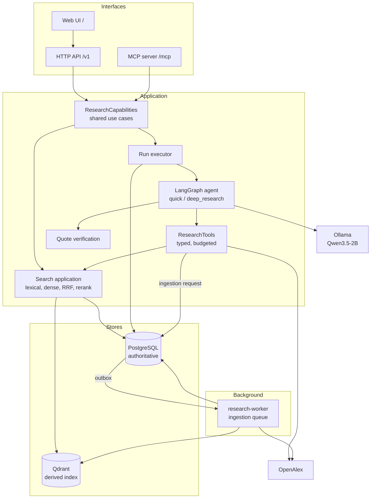
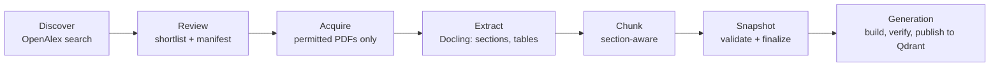
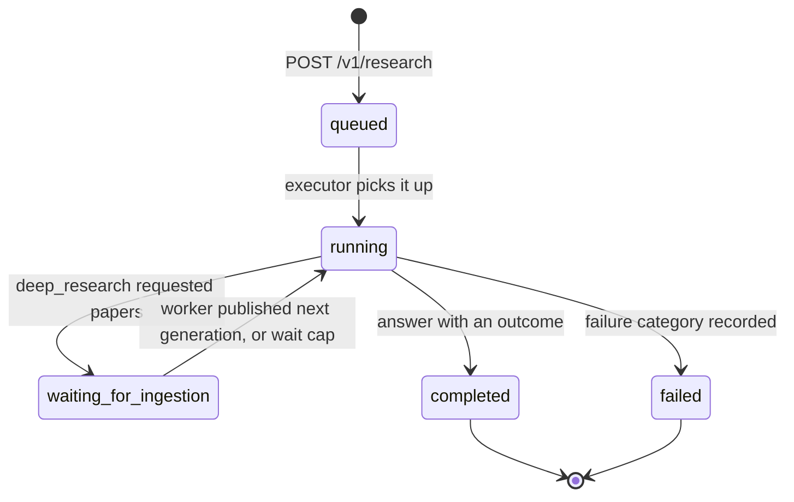

# 3. How it works

This chapter follows the data from a PDF to a verified answer. The [architecture overview](../architecture/overview.md) has the component table and a detailed sequence diagram; this chapter explains the reasoning.

## Components

Everything except the worker and Ollama runs in one process: the FastAPI application. The API loads the embedding and reranker models once and shares them between HTTP search, the agent and MCP. On a 4 GB GPU, loading them a second time would not fit; that is why MCP runs inside the API instead of as a separate stdio server.

The layers follow the [specification's layering rule](../agents/scientific-research-platform-source-of-truth.md#71-layering). Routes, LangGraph nodes and MCP handlers never contain SQL, Qdrant queries or ranking logic. They call `ResearchCapabilities` (HTTP and MCP) or `ResearchTools` (the agent), which call the search, paper and run services. CI enforces this with an [import-boundary test](../../tests/test_phase5_gate_import_boundary.py).

## Stage 1: building the corpus

The corpus is built once, offline, with the `research-ingest` command. [Corpus and ingestion](08-corpus-and-ingestion.md) has the commands.

- **Discovery** queries OpenAlex with versioned configurations and produces an explainable shortlist. A reviewer approves a manifest that records an inclusion or exclusion reason for every candidate.
- **Acquisition** downloads a PDF only from a bounded set of sources (OpenAlex content, Springer Nature, version-pinned arXiv, Glasgow Eprints) and only with recorded permission evidence: license, source URL, checksum and version. Papers without a permitted source stay metadata-only. See [ADR-0007](../adr/0007-bounded-direct-source-pdf-downloads.md).
- **Extraction** uses Docling's standard PDF pipeline. Tables keep headers, values, units, captions and footnotes; large tables are split into row groups that repeat their headers. Results tables that fail validation are flagged for manual review instead of being silently accepted. See [ADR-0004](../adr/0004-phase1-pdf-extraction.md).
- **Chunking** respects section boundaries for prose and keeps table structure. Each chunk has a stable ID and character offsets into its section.
- **Snapshots** freeze membership, document versions and configuration. Finalizing a snapshot checks permissions, chunk membership, Qdrant counts and a fingerprint of the indexed evidence IDs. See [ADR-0001](../adr/0001-versioned-corpus-evidence.md) and [ADR-0002](../adr/0002-finalize-validated-snapshots.md).
- **Generations** publish a finalized snapshot into two Qdrant collections: passages and papers. `verify` compares exact evidence IDs, text hashes and payloads with PostgreSQL, and runs self-retrieval probes. A generation with correct counts but wrong IDs is not published. See [ADR-0023](../adr/0023-phase35-index-generations.md).

Every step is idempotent and resumable. Extraction and chunking keep separate checkpoints, a failed paper can be retried from the failed stage, and a crashed job's lease is reclaimed.

## Stage 2: search

The search pipeline follows the [locked retrieval contract](../agents/scientific-research-platform-source-of-truth.md#91-required-pipeline--locked):

1. **Validate** the query and filters, and resolve which records are eligible (snapshot membership, year range, paper IDs, evidence kinds, version kinds). Filters are applied before ranking, so they never depend on prompt text.
2. **Lexical retrieval**: BM25 with the `scientific-en-v1` analyzer, executed by Qdrant as sparse vectors with an IDF modifier. Top 50.
3. **Dense retrieval**: `Alibaba-NLP/gte-modernbert-base` embeddings, exact search in Qdrant. Top 50.
4. **Fusion**: Reciprocal Rank Fusion with rank constant 10. Top 50.
5. **Reranking**: the `cross-encoder/ettin-reranker-150m-v1` cross-encoder rescores the first 16 fused candidates; the rest follow in fused order. If reranking fails, the response says so and returns the fused order. It never fails silently.
6. **Selection**: remove overlapping duplicates, cap support passages per paper (5), and keep the result within the evidence budget (4,000 tokens or 12,000 characters).
7. **Return** hits with lexical, dense, fusion and reranker ranks and scores, stable IDs, source spans and page locations.

[Search](09-search.md) covers modes, filters and response semantics.

## Stage 3: a research run

1. **Admission.** The API validates the request, checks the caller's scope and active-run limit, and writes a `queued` run to PostgreSQL before returning `202`.
2. **Pinning.** The executor pins the run to the currently published snapshot and generation, records the effective configuration and its `sha256` hash, and starts the LangGraph graph with a PostgreSQL checkpointer.
3. **Gathering evidence.**
   - `quick`: search papers (10 hits), take up to five candidates, search evidence within them (20 results), note relevant papers that are not ingested, then answer.
   - `deep_research`: the model **plans** a batch of typed tool calls. Code validates and **executes** them, deduplicating identical calls. The model then **evaluates** whether the evidence suffices, and the loop repeats until it does or a budget runs out. If the model requested ingestion, the run waits (at most 900 s, outside its active-time budget) for the worker, then switches once to the new generation.
4. **Synthesis.** The evidence is packed into the prompt under handles `E1`, `E2`, and so on; tables are shown as labelled rows. The model thinks, then returns structured JSON. Each claim gives one handle, one quote copied from that passage, and the claim text. If no claim survives verification, synthesis is retried with the next seed, up to three attempts.
5. **Verification.** For each drafted claim, code checks that the handle exists and was shown to the model, that the quote occurs in that passage, and that the claim stays within its quote: content words, numbers, and scope words such as "both", "all" or "highest". [Research runs](10-research-runs.md#quote-verification) lists the exact checks. A claim that fails but whose quote passes is kept *as the quote*. Every draft and its verdict is stored.
6. **Outcome.** The run completes as `answered`, `partially_supported` or `insufficient_evidence`, or fails with a category.
7. **Persistence.** The answer, claims with chunk and paper IDs, tool calls, model calls (with token counts and decoding settings), drafts and usage are written to PostgreSQL.

If the API restarts mid-run, the executor resumes the run from its last checkpoint, at most twice. A run whose effective configuration has changed since it started fails with `configuration_changed` rather than mixing configurations.

[Research runs](10-research-runs.md) covers budgets, outcomes and the response shape.

## Stage 4: explaining a run

Given a run ID, `research-runs explain` reads its run records (and optionally its JSONL trace spans) and names the stage where it lost its answer: planning, retrieval, evidence, generation, verification, model, budget, ingestion or infrastructure. `research-runs reproduce` recomputes the configuration hash and prints a recipe (git checkout, environment, mode, filters, seed) for rerunning it. See [Evaluation](11-evaluation.md#diagnosing-a-run).

## Why PostgreSQL and Qdrant both hold evidence text

Qdrant point payloads carry a copy of each passage with its `text_sha256`, so search can return evidence without a database round trip per hit. PostgreSQL stays authoritative: it decides membership and permissions, and generation verification checks every Qdrant hash against it. If Qdrant is lost, `research-ingest generations rebuild` replays the published generations from PostgreSQL and the stored artifacts. See [ADR-0022](../adr/0022-phase35-qdrant-search-and-content.md).

Next: [HTTP API](04-http-api.md).
