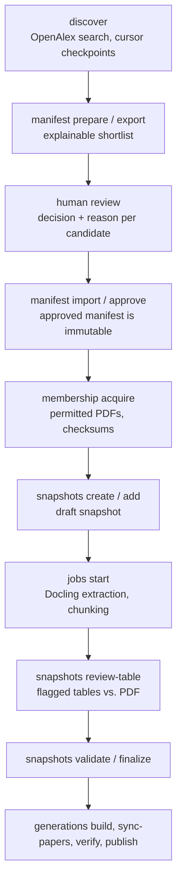

# 8. Corpus and ingestion

The corpus is what every search and answer depends on, so building it is deliberate, reviewed and reproducible. This chapter explains the workflow and the rules behind it. The step-by-step commands, with every flag, are in the [ingestion operations guide](../operations/phase-1-ingestion.md) and the [generation section of the search guide](../operations/phase-2-search.md#index-generations-phase-35).

## The accepted corpus

| Property | Value |
| --- | --- |
| Scope | English papers on retrieval, reranking and RAG, 2020 onward, with explicit exceptions for older foundational work. Negative and mixed findings are included. |
| Papers | 100, all CC BY, each with exact-file permission evidence |
| Searchable chunks | 44,277 |
| Snapshot | `4b11fab3-d4a5-4e7a-a58e-8654accf2c6c`, finalized 2026-09-26 |
| Source PDFs | 116,492,245 bytes |
| Served as | Collection `research-corpus`, generation 1, Qdrant collections `research-passages-gte-bm25-v1` and `research-papers-gte-bm25-v1` |

The acceptance evidence is in the [100-paper acceptance report](../reference/phase-1-100-paper-acceptance-report.md): 269 of 269 sampled numeric values were present, 102 table reviews were recorded, and 44,277 PostgreSQL and Qdrant evidence IDs reconciled.

## Rules that shape the workflow

These come from the [corpus policy](../agents/scientific-research-platform-source-of-truth.md#86-phase-1-corpus-policy--locked):

- **Permission before storage.** Downloadability is not permission. Each document version records its license, source URL, acquisition time, checksum, and separate decisions for storage, indexing and public display.
- **One paper, many versions.** A paper is the logical work; a snapshot indexes one selected document version per paper, preferring the published version.
- **Real citations only.** Citation edges come from OpenAlex identifiers. Unresolved targets are kept as unresolved, never invented.
- **Tables are first-class.** Headers, values, units, captions and footnotes are preserved. A results table that fails validation blocks the paper until it is reviewed; it is never silently dropped.
- **Nothing is silently filtered.** Exclusions and replacements are explicit, recorded decisions.
- **Drafts are not served.** Only a finalized snapshot, with validated membership, versions, configuration and index integrity, is used for research.

## Offline workflow

1. **Discover.** `research-ingest discover --config configs/phase1-discovery.example.json` runs a bounded OpenAlex search: one request at a time, at most 50 requests per run, with bounded retries and resumable cursors.
2. **Shortlist and review.** `manifest prepare` builds a shortlist with recorded selection signals: query origin, OpenAlex rank and older-paper exceptions. `export` writes it to JSON for review; `import` and `approve` record the decisions under a named reviewer. PostgreSQL then prevents edits. `manifest report` summarizes yield and coverage.
3. **Acquire.** Downloads come from a fixed set of hosts with request bounds and a storage cap (2 GiB), and only with permission evidence ([ADR-0007](../adr/0007-bounded-direct-source-pdf-downloads.md)). Files are content-addressed and stored once.
4. **Extract and chunk.** `jobs start` runs Docling over each document and chunks the result. Extraction and chunking keep separate checkpoints. A paper-specific failure does not stop the others. `jobs resume` continues after an interruption, and `jobs retry --from-stage extraction|chunking --reason ...` retries one document.
5. **Review.** Flagged tables are checked against the PDF with `snapshots review-table`. Corrections become new, source-linked extraction versions (`apply-corrections`); the original output is never edited in place.
6. **Finalize.** `snapshots validate` checks evidence, rights and Qdrant reconciliation. `snapshots finalize --reviewer NAME` freezes the snapshot, requiring 100 papers by default.
7. **Publish.** `generations build` embeds and indexes the snapshot into the generation's collections. `sync-papers` updates paper records, `verify` checks everything against PostgreSQL, and `publish` moves the serving pointer.

The extraction choice (Docling's standard pipeline, with a Granite-Docling VLM used only as a review aid for hard tables) and its thresholds are in [ADR-0004](../adr/0004-phase1-pdf-extraction.md) and the [extraction comparison](../reference/phase-1-extraction-comparison.md).

## Index generations

A generation is a finalized snapshot published to Qdrant. Generation N+1 contains generation N plus new papers. Points carry `added_generation` and `retired_generation` tags, so one collection serves every generation without copying data.

- **Run pinning.** A research run records the generation it started on, and reads only that generation unless it explicitly switches after its own ingestion request.
- **Verification before publish.** `verify` compares exact evidence IDs, text hashes and payload fields, and runs self-retrieval probes. Correct counts with wrong IDs fail.
- **Rebuild.** `generations rebuild` replays every published generation from PostgreSQL and artifacts into empty collections.
- **Purge.** `generations purge --apply` deletes only points that no published generation or unfinished run can see.
- **Drift.** If a new generation's average evidence length drifts more than 10% from its configuration, the generation records `new_configuration_recommended`. Creating a new configuration is manual.

See [ADR-0023](../adr/0023-phase35-index-generations.md).

## Online ingestion

Since Phase 3.5, papers can also be added while the system runs ([ADR-0024](../adr/0024-phase35-online-discovery-and-ingestion.md)):

- A `deep_research` run can call `discover_papers` (OpenAlex search; abstracts become labelled *abstract evidence*) and `request_ingestion`.
- `POST /v1/collections/{collection_id}/ingest` uses the same path.

Code, not the model, decides each proposed paper against the `online-membership-v1` policy and records every decision. Accepted papers become one ingestion request in a PostgreSQL outbox. `research-worker`, with `RESEARCH_PLATFORM_INGESTION_HANDLER=online`:

1. claims the request with a lease;
2. takes a PostgreSQL GPU advisory lock and unloads the Ollama model to free GPU memory;
3. acquires each permitted PDF, reusing stored copies;
4. extracts with Docling and chunks with the published snapshot's chunking configuration;
5. finalizes a child snapshot and builds, verifies and publishes the next generation.

Papers without a permitted source stay metadata-only. A paper whose extraction needs manual table review is refused with `validation:flagged_table_review_pending`. Budgets are enforced in code: 10 searches and 5 downloads per run, 5 papers per wait, and a $0.50 daily spend cap. There is no recursive acquisition of referenced papers.

**Known limitation.** In live evaluation the planner did not choose discovery or ingestion on its own, and forced ingestion of table-heavy papers stopped at the table-review rule. See [Failure analysis](../reference/failure-analysis.md).

## Storage and cleanup

Artifacts live outside Git under `data/artifacts`, content-addressed; metadata, checksums and job state live in PostgreSQL. `research-ingest storage inspect` shows usage against the cap. `storage cleanup-preview` lists old unreferenced files, and `storage cleanup --older-than-hours N --apply` removes them. Cleanup refuses to run while a job is active and never touches an artifact linked to a document.

Next: [Search](09-search.md).
