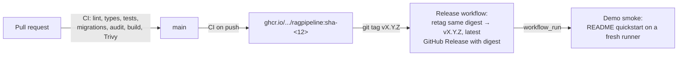

# 13. Operations

This chapter summarizes how the system is released, deployed and kept healthy. The full procedures, with every command, are in the [deployment and operations guide](../operations/deployment.md).

## Release flow



- CI pushes an immutable image tagged with the commit (`sha-<12 characters>`), but only after every check passes on a push to `main`.
- A version tag (`v*.*.*`) **retags** that tested image; it never rebuilds. The release notes record the image digest.
- The `demo-smoke` workflow then follows the README quickstart against the released image on a fresh GitHub runner.
- Images are `linux/amd64`. Model weights are not baked into the image; they are fetched into a volume at pinned revisions.

v0.6.0 is the current release (commit `977e7aa`). Its demo smoke run passed in 7 minutes. See the [Phase 6 gate report](../reference/phase-6-gate-report.md).

## Run a specific version

```bash
export RESEARCH_PLATFORM_IMAGE=ghcr.io/avsngh-git/ragpipeline:v0.6.0      # or @sha256:<digest>
docker compose pull api
docker compose run --rm --no-deps api research-migrate
docker compose up -d
```

## Migrations

Migrations are plain SQL files in `migrations/` (001 to 028), applied in order by `research-migrate`, which records each applied version. They are forward-only, so **back up PostgreSQL before upgrading**. Qdrant is not migrated; it is derived and can be rebuilt.

## Backup and restore

| Store | Backup | Restore |
| --- | --- | --- |
| PostgreSQL | `pg_dump --format=custom` from the `postgres` container | Stop the API, then `pg_restore --clean --create` |
| Qdrant | Collection snapshots through the REST API, or nothing: it can be rebuilt | Upload a snapshot into an empty collection, or `research-ingest generations rebuild` |
| Artifacts | Copy `data/artifacts` (content-addressed PDFs) | Copy back |
| Models | Nothing needed | `research-demo fetch-models` |

PostgreSQL dumps contain the application database, including run records and key hashes; keep them protected.

## Rollback

Set `RESEARCH_PLATFORM_IMAGE` to the previous release and run `docker compose up -d`. If the newer version already applied migrations, stop the API and restore the PostgreSQL backup taken before the upgrade first. There is no automatic deployment, so rollback is always a deliberate step.

## Failure recovery

| Symptom | Action |
| --- | --- |
| `/ready` returns 503 | The body names the unavailable dependency. Check `docker compose ps` and `docker compose logs api`. |
| Search fails with missing model files | `docker compose run --rm --no-deps -e HF_HUB_OFFLINE=0 -e TRANSFORMERS_OFFLINE=0 api research-demo fetch-models`, then restart the API |
| Qdrant collection missing | Rebuild from PostgreSQL into empty collections, or reload the demo with `scripts/demo_load.sh --reset` (which erases all volumes) |
| A run was interrupted | On startup the executor resumes it from its checkpoint, at most twice; then it fails with `resume_exhausted` |
| Runs fail with `model_unavailable` | Start Ollama (`docker compose --profile llm up -d ollama`) and check the model is imported and `100% GPU` |
| Ollama killed for running out of memory | Keep `LLAMA_ARG_CACHE_RAM` set; stop the observability profile during long sweeps on small machines |
| 429 responses | Wait for `Retry-After`; adjust `RESEARCH_PLATFORM_RATE_LIMIT_*` if needed |
| Disk full | `docker system df`, then `docker image prune`. Do not remove volumes unless you mean to erase data. |

## Retention

Nothing is deleted automatically. `research-maintenance retention` reports eligible data; with `--apply` it deletes checkpoints 7 or 30 days after completed or failed runs, and model-call text after 90 days. With `--collection-name` and `--configuration` it also purges retired Qdrant points that no published generation or unfinished run can see. `research-runs prune --older-than-days N` deletes whole terminal runs. See the [retention guide](../operations/retention.md).

## Keys

```bash
docker compose exec api research-keys create --principal operator --scope read --scope research
docker compose exec api research-keys list
docker compose exec api research-keys revoke KEY_ID
```

Give each client only the scopes it needs. Rotate a key by creating a new one, switching the client, then revoking the old one.

## Hosting

There is no hosted environment; the owner declined recurring hosting costs ([ADR-0033](../adr/0033-phase6-delivery-without-hosting.md)). If one is added later, it should run a released image, use `production` mode, keep the API behind TLS, set the MCP allow-lists and avoid a permanently running GPU.

Next: [Development](14-development.md).
